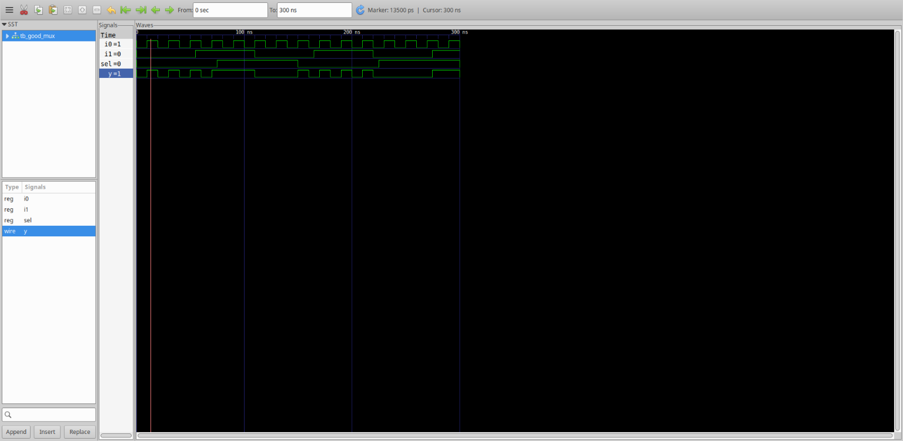
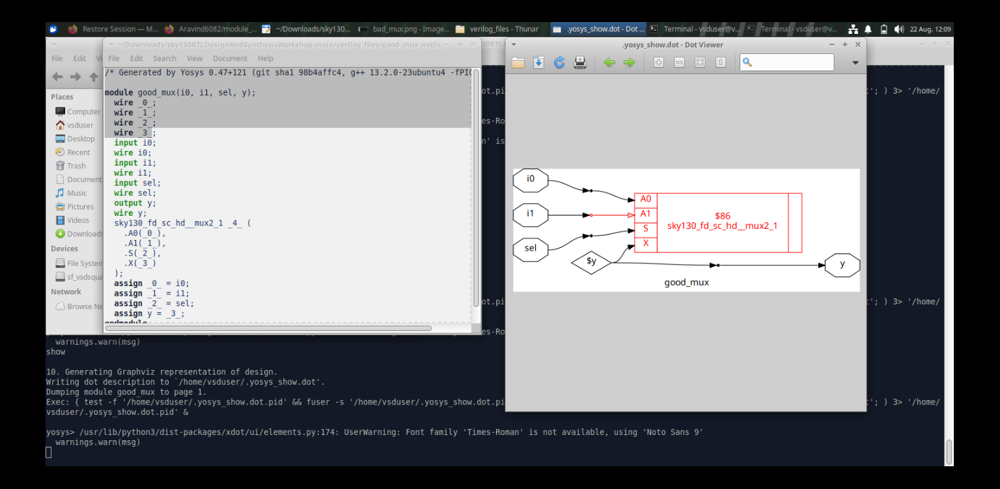

# Module 1 — RTL Design and Simulation

## Overview

Module 1 introduces the first stage of the RTL design flow using a simple **2:1 multiplexer (`good_mux`)**.

The purpose of the experiment is not only to implement a MUX, but to establish the basic engineering loop used throughout the later modules:

```text
RTL
 ↓
Simulation
 ↓
Waveform Verification
 ↓
Synthesis
 ↓
Hardware Representation
```

---

## Table of Contents

1. [Objectives](#1-objectives)
2. [Design Under Test](#2-design-under-test)
3. [Functional Behavior](#3-functional-behavior)
4. [Simulation and Waveform](#4-simulation-and-waveform)
5. [Synthesized Representation](#5-synthesized-representation)
6. [RTL vs Hardware View](#6-rtl-vs-hardware-view)
7. [Observations](#7-observations)
8. [Key Learning](#8-key-learning)
9. [Module Takeaway](#9-module-takeaway)

---

## 1. Objectives

The main objectives are:

- Understand a simple combinational RTL design.
- Relate inputs, control signals and outputs.
- Understand the role of simulation in RTL verification.
- Interpret a waveform generated from a design.
- Observe the difference between RTL intent and synthesized hardware.

---

## 2. Design Under Test

The Design Under Test is a 2:1 multiplexer named `good_mux`.

```text
        +---------+
i0 ---->|         |
        |  2:1    |----> y
i1 ---->|   MUX   |
        |         |
sel --->|         |
        +---------+
```

Signals:

| Signal | Role |
|---|---|
| `i0` | First data input |
| `i1` | Second data input |
| `sel` | Selection control |
| `y` | Selected output |

---

## 3. Functional Behavior

The MUX selects one of the two inputs according to `sel`.

```text
sel = 0 → y = i0
sel = 1 → y = i1
```

This simple relationship makes the MUX useful for demonstrating the complete RTL-to-simulation flow.

---

## 4. Simulation and Waveform

The supplied waveform records the simulated behavior of the MUX.



### What to observe

When reading the waveform, check:

1. The value of `sel`.
2. The current values of `i0` and `i1`.
3. Whether `y` follows the selected input.
4. Whether output changes correspond to input/control changes.

The waveform therefore acts as functional evidence that the RTL behaves according to the intended MUX function.

---

## 5. Synthesized Representation

The synthesized representation is shown below.



At this stage, the design is no longer viewed only as Verilog statements. It is represented structurally as hardware logic.

---

## 6. RTL vs Hardware View

A useful distinction established in this module is:

```text
RTL View
    ↓
Describes intended behavior

Synthesized View
    ↓
Shows inferred hardware structure
```

Simulation answers:

> **Does the RTL behave correctly?**

Synthesis inspection answers:

> **What hardware structure is inferred from the RTL?**

Both views are required for a complete design understanding.

---

## 7. Observations

- A simple combinational design can be described compactly in RTL.
- Simulation allows functional behavior to be checked before relying on the synthesized structure.
- Waveforms show signal relationships over time.
- Synthesis converts behavioral/RTL intent into structural hardware.

---

## 8. Key Learning

- RTL and synthesized hardware are two different representations of the same design.
- A testbench provides the stimulus needed for functional verification.
- Waveform inspection is an important debugging and verification step.
- Synthesis provides the bridge from RTL code to hardware implementation.

---

## 9. Module Takeaway

Module 1 establishes the foundation for every later experiment:

```text
Describe
   ↓
Simulate
   ↓
Observe
   ↓
Synthesize
   ↓
Inspect
```

The same cycle becomes more complex in Modules 2–5 as sequential logic, optimization, coding styles and synthesized-design simulation are introduced.
