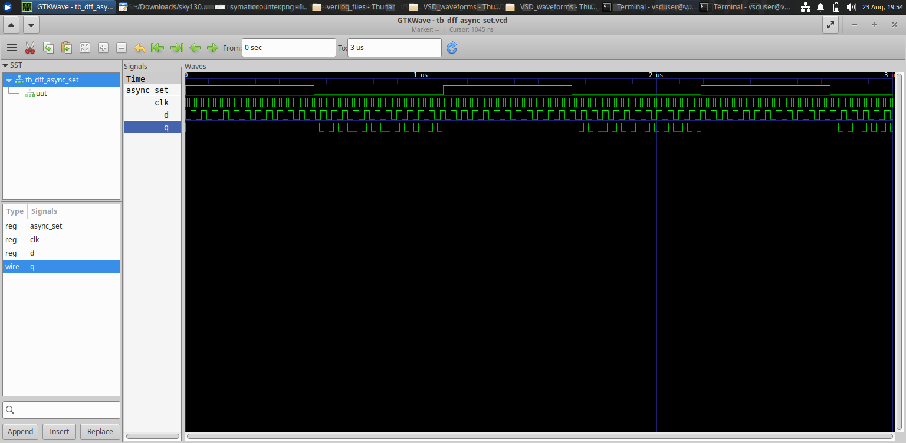
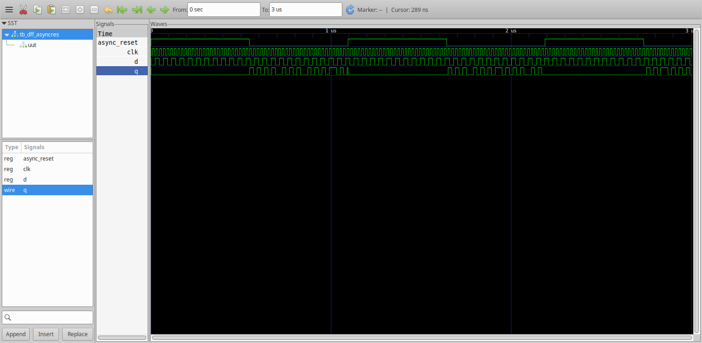
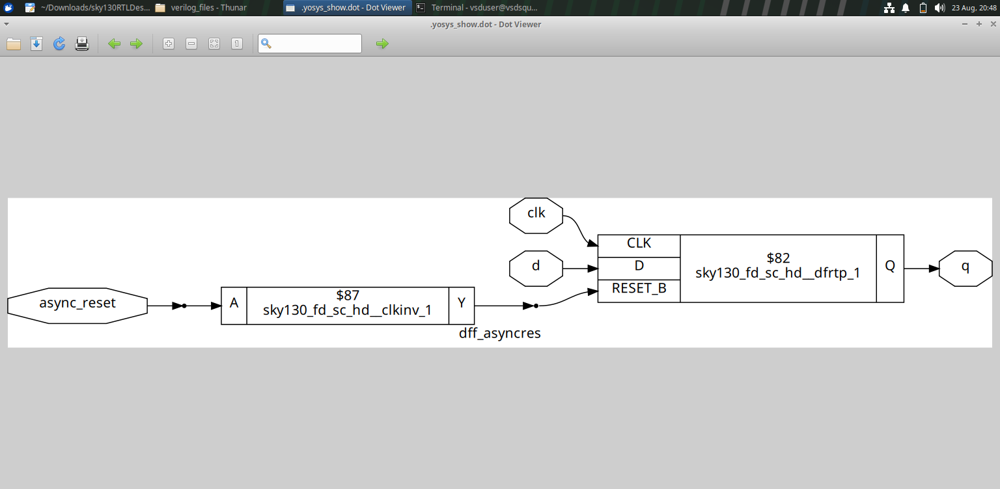
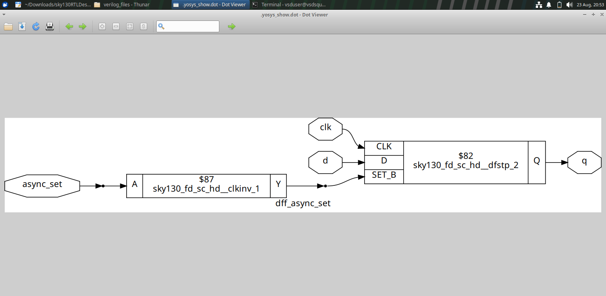
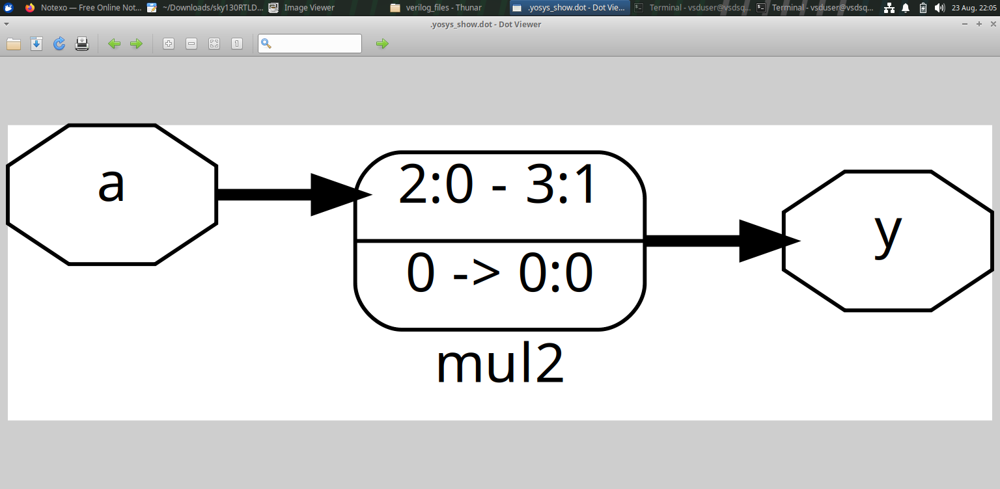
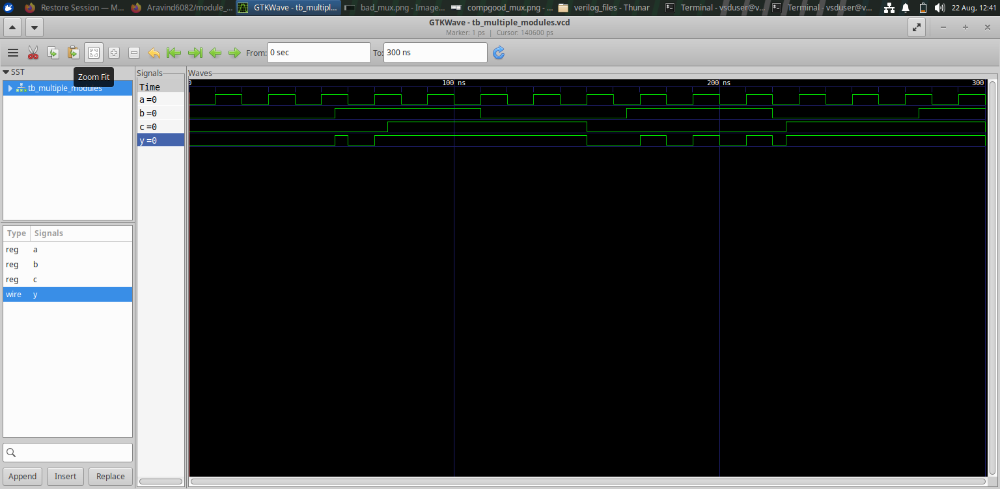
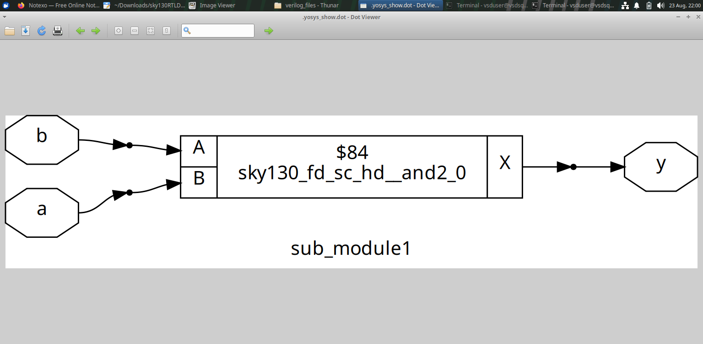

# Module 2 — Sequential Logic and RTL Synthesis

## Overview

Module 2 extends the basic RTL flow into **sequential logic, synthesis and hierarchical design**.

The experiments cover asynchronous reset/set behavior, synthesized sequential structures, arithmetic logic and multi-module RTL organization.

---

## Table of Contents

1. [Objectives](#1-objectives)
2. [Sequential Logic](#2-sequential-logic)
3. [Asynchronous Reset](#3-asynchronous-reset)
4. [Asynchronous Set](#4-asynchronous-set)
5. [Simulation vs Synthesis](#5-simulation-vs-synthesis)
6. [Multiplier Experiments](#6-multiplier-experiments)
7. [Hierarchical Design](#7-hierarchical-design)
8. [Why Netlist Inspection Matters](#8-why-netlist-inspection-matters)
9. [Key Learning](#9-key-learning)
10. [Module Takeaway](#10-module-takeaway)

---

## 1. Objectives

This module focuses on:

- Sequential RTL behavior.
- D flip-flop based storage.
- Asynchronous reset and set.
- Simulation and waveform inspection.
- Synthesis of sequential logic.
- Arithmetic synthesis.
- Hierarchical module organization.
- Structural inspection of synthesized hardware.

---

## 2. Sequential Logic

Unlike combinational logic, sequential logic stores state.

A D flip-flop can be viewed conceptually as:

```text
       D
       │
       ▼
   +-------+
   |  DFF  |----> Q
   +-------+
       ▲
       │
      CLK
```

The output depends not only on the current input but also on the clocked storage behavior.

Asynchronous controls introduce additional behavior that can act independently of the normal data capture event.

---

## 3. Asynchronous Reset

### Simulation



### Waveform



### Synthesized Netlist



### Observation

The experiment provides three complementary views:

```text
RTL / stimulus
      ↓
Simulation waveform
      ↓
Synthesized sequential structure
```

The waveform is used to understand behavior, while the netlist shows how that behavior is represented structurally after synthesis.

---

## 4. Asynchronous Set

The synthesized asynchronous-set structure is:



The figure demonstrates that asynchronous control behavior is represented explicitly in the synthesized sequential cell structure.

---

## 5. Simulation vs Synthesis

The two stages answer different questions.

| Stage | Main Question |
|---|---|
| RTL Simulation | Does the described logic behave correctly? |
| Synthesis | What hardware structure represents that RTL? |
| Netlist Inspection | Which cells and connections were inferred? |
| Synthesized Simulation | Does the synthesized representation preserve the intended behavior? |

This distinction becomes increasingly important in Modules 3–5.

---

## 6. Multiplier Experiments

### Multiplier by 2



### Multiplier by 8 — Synthesized Representation


These experiments show that arithmetic RTL can be represented structurally after synthesis.

The important learning is to compare the high-level arithmetic description with the hardware structure generated by the synthesis process.

---

## 7. Hierarchical Design

Hierarchical RTL divides a larger design into smaller modules.

### RTL / Hierarchical Design


### Simulation



### Synthesized Structure


### Submodule



The experiment demonstrates the relationship:

```text
Submodule 1
     ↓
Intermediate Connection
     ↓
Submodule 2
     ↓
Top-Level Output
```

Hierarchy helps organize a larger RTL design into understandable blocks.

---

## 8. Why Netlist Inspection Matters

A design may look simple at the RTL level while its synthesized implementation contains:

- storage elements,
- logic cells,
- interconnections,
- technology-specific cells,
- optimized structures.

Therefore, looking at the synthesized netlist provides an additional level of understanding beyond RTL simulation.

---

## 9. Key Learning

- Sequential RTL infers storage elements.
- Asynchronous controls become part of the synthesized sequential structure.
- Simulation and synthesis answer different questions.
- Arithmetic operations can be inspected after synthesis.
- Hierarchical RTL allows larger designs to be divided into manageable modules.
- Netlist inspection connects RTL intent with physical hardware structure.

---

## 10. Module Takeaway

Module 2 establishes the transition:

```text
Combinational RTL
       ↓
Sequential RTL
       ↓
Simulation
       ↓
Synthesis
       ↓
Netlist / Cell Structure
       ↓
Hierarchical Hardware
```

This prepares the design flow for the optimization studies in Module 3.
