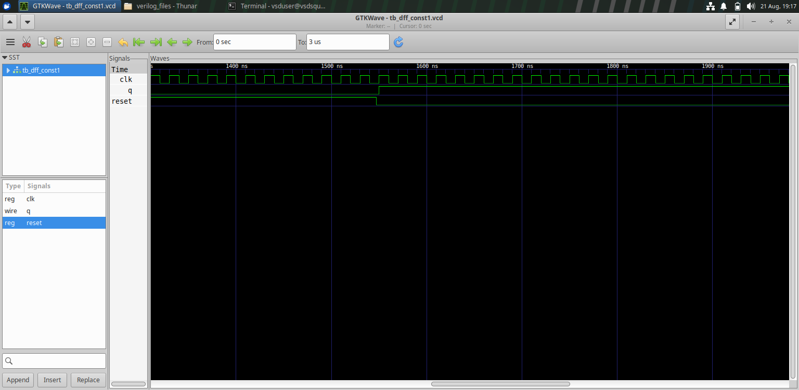
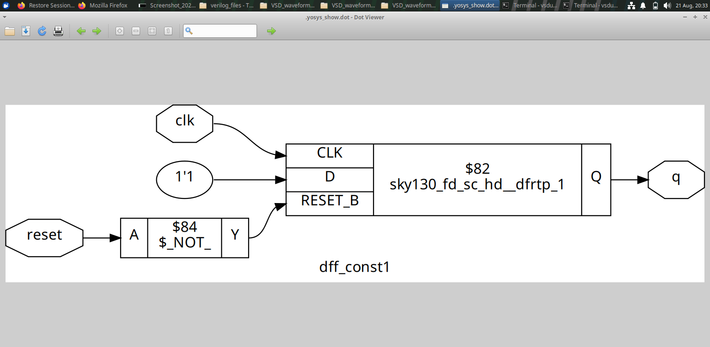
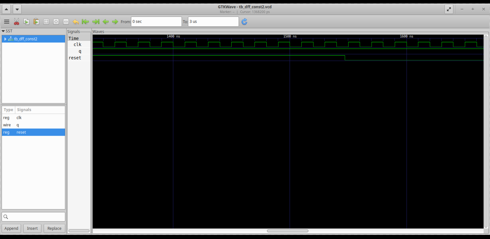
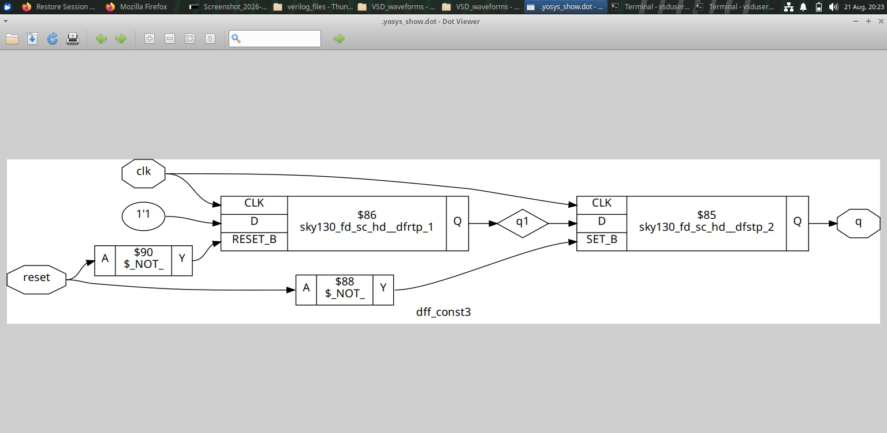

# Module 3 — Combinational and Sequential Optimization

## Overview

Module 3 focuses on how synthesis can optimize **sequential and combinational hardware structures**.

The supplied experiments include constant-driven DFFs and counter optimization. The main idea is to understand that synthesis does not simply reproduce the RTL structure; it analyzes the logic and can simplify or transform it.

---

## Table of Contents

1. [Objectives](#1-objectives)
2. [Optimization Concept](#2-optimization-concept)
3. [Constant-Driven DFF Experiments](#3-constant-driven-dff-experiments)
4. [Counter Optimization](#4-counter-optimization)
5. [Reading Synthesis Results](#5-reading-synthesis-results)
6. [Design Implications](#6-design-implications)
7. [Key Learning](#7-key-learning)
8. [Module Takeaway](#8-module-takeaway)

---

## 1. Objectives

The module investigates:

- Constant-driven sequential logic.
- Sequential optimization.
- Counter optimization.
- Changes between RTL intent and synthesized hardware.
- Schematic/netlist inspection as an optimization method.

---

## 2. Optimization Concept

A useful model for synthesis is:

```text
RTL
 ↓
Elaboration
 ↓
Logic Inference
 ↓
Optimization
 ↓
Technology Mapping
 ↓
Hardware Structure
```

Optimization attempts to preserve functionality while producing a simpler or more suitable hardware implementation.

The experiments in this module provide practical examples of this transformation.

---

## 3. Constant-Driven DFF Experiments

The module contains three constant-related DFF experiments.

### Experiment 1





### Experiment 2


### Experiment 3





### What to Compare

For each experiment, compare:

```text
RTL behavior
    ↕
Simulation waveform
    ↕
Synthesized schematic
```

This comparison helps identify what portion of the RTL is actually necessary in the resulting hardware.

---

## 4. Counter Optimization

The counter experiments provide synthesized schematic views.

### Counter Optimization — View 1


### Counter Optimization — View 2


A counter is a useful optimization example because its RTL may contain several state and arithmetic relationships that synthesis can transform into a more compact hardware structure.

---

## 5. Reading Synthesis Results

When inspecting an optimized schematic, focus on:

- Which registers remain.
- Which logic elements remain.
- Whether apparently redundant logic has disappeared.
- How signals are connected after optimization.
- Whether the synthesized structure still represents the intended functionality.

This approach is more informative than judging optimization only by the number of RTL statements.

---

## 6. Design Implications

The experiments reinforce an important hardware-design principle:

> RTL describes hardware intent, while synthesis determines a realizable structural implementation of that intent.

Therefore, a designer should understand both:

```text
What the RTL says
        +
What synthesis produces
```

---

## 7. Key Learning

- Constant conditions can simplify sequential hardware.
- Synthesis can remove or transform unnecessary structures.
- Counter logic can be optimized at synthesis.
- Waveforms verify behavior while schematics reveal structure.
- Optimization should be evaluated from the synthesized hardware, not only from source-code appearance.

---

## 8. Module Takeaway

Module 3 introduces synthesis-aware thinking:

```text
Write RTL
   ↓
Ask what hardware it implies
   ↓
Synthesize
   ↓
Inspect
   ↓
Compare
   ↓
Optimize the RTL intent
```

This naturally leads to Module 4, where coding style and simulation semantics become the focus.
