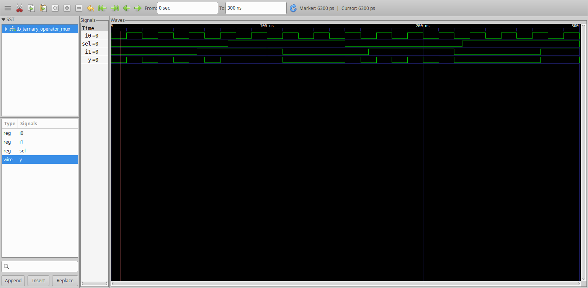
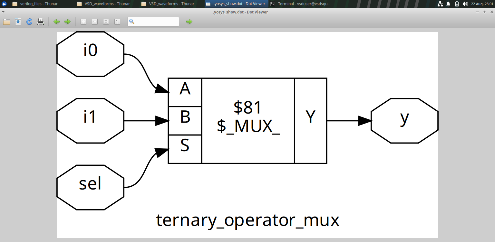
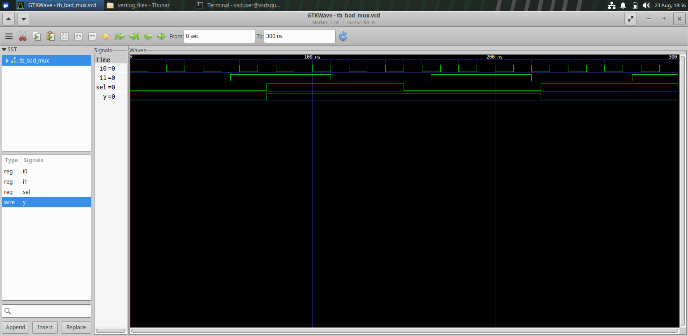
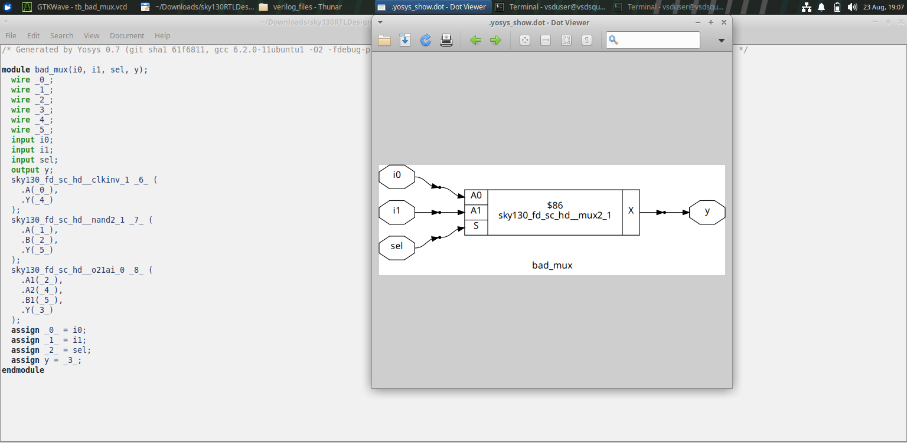
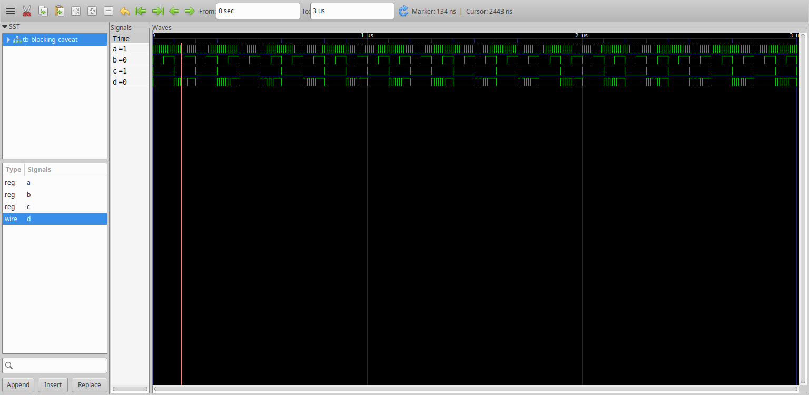
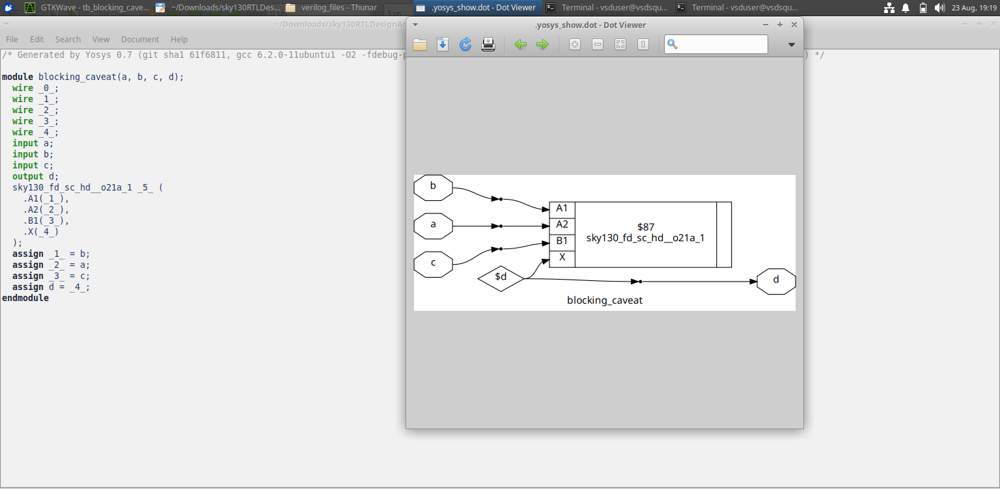

# Day 4 — GLS, Blocking vs Non-Blocking and Synthesis Simulation

## Overview

Module 4 studies how **RTL coding style, simulation semantics and synthesized hardware** are related.

The supplied experiments include ternary-operator MUX coding, an undesirable/incomplete MUX example and a blocking-assignment caveat.

---

## Table of Contents

1. [Objectives](#1-objectives)
2. [Ternary-Operator MUX](#2-ternary-operator-mux)
3. [Bad MUX Example](#3-bad-mux-example)
4. [Blocking Assignment Caveat](#4-blocking-assignment-caveat)
5. [Synthesis and Simulation Relationship](#5-synthesis-and-simulation-relationship)
6. [Why Coding Style Matters](#6-why-coding-style-matters)
7. [Key Learning](#7-key-learning)
8. [Module Takeaway](#8-module-takeaway)

---

## 1. Objectives

The module focuses on:

- RTL coding styles.
- Ternary operator based MUX implementation.
- Incomplete/undesirable MUX descriptions.
- Blocking assignment behavior.
- Synthesized netlist inspection.
- Simulation of synthesized logic.
- Comparing RTL intent with synthesized behavior.

---

## 2. Ternary-Operator MUX

A MUX can be described using a compact conditional expression.

### Simulation



### Synthesized Netlist



The experiment demonstrates how a concise RTL description can map to a recognizable MUX structure.

---

## 3. Bad MUX Example

The module also contains a MUX example illustrating an undesirable/incomplete coding case.

### Schematic


### Simulation



### Netlist



### What to Study

Compare all three views:

```text
RTL / coding style
       ↓
Simulation behavior
       ↓
Synthesized hardware
```

The comparison shows why incomplete combinational descriptions should be treated carefully.

---

## 4. Blocking Assignment Caveat

### Simulation



### Synthesized Netlist



The experiment demonstrates that procedural assignment semantics affect simulation behavior and must be considered when writing sequential RTL.

The important lesson is not simply that one assignment operator is shorter or easier to type, but that the operator communicates a particular simulation behavior.

---

## 5. Synthesis and Simulation Relationship

The experiments follow this general verification path:

```text
RTL
 ↓
RTL Simulation
 ↓
Synthesis
 ↓
Synthesized Netlist
 ↓
Synthesized-Design / Gate-Level Simulation
 ↓
Waveform Comparison
```

The purpose is to establish confidence that the synthesized representation preserves the intended behavior.

---

## 6. Why Coding Style Matters

Coding style is part of hardware intent.

A designer should consider:

- What hardware is intended?
- Is the RTL complete for all required conditions?
- Does the procedural behavior match the intended sequential/combinational behavior?
- What does synthesis infer?
- Does the synthesized design simulate as expected?

This is the bridge between RTL coding discipline and synthesis-aware design.

---

## 7. Key Learning

- Ternary expressions can describe MUX structures.
- Incomplete combinational descriptions can infer unintended hardware.
- Blocking assignment semantics matter during simulation.
- Synthesized netlists provide a structural check on RTL intent.
- Synthesized-design simulation provides another verification stage.

---

## 8. Module Takeaway

Module 4 develops the habit of verifying both **behavior and implementation**:

```text
RTL Coding
    ↓
Simulation Semantics
    ↓
Synthesis
    ↓
Netlist
    ↓
Synthesis / GLS Verification
```

This prepares the workflow for the coding-style-driven synthesis optimization experiments in Module 5.
