# Day 5 — Optimization in Synthesis

## Overview

Module 5 focuses on how **combinational RTL completeness and coding style affect synthesis results**.

The supplied experiments cover incomplete and complete `if`/`case` descriptions, partial case assignments, MUX/DEMUX structures, `generate` constructs and a ripple-carry adder.

---

## Table of Contents

1. [Objectives](#1-objectives)
2. [Incomplete If Statements](#2-incomplete-if-statements)
3. [Incomplete Case Statements](#3-incomplete-case-statements)
4. [Complete Case Statements](#4-complete-case-statements)
5. [Partial Case Assignment](#5-partial-case-assignment)
6. [MUX and DEMUX](#6-mux-and-demux)
7. [Generate-Based Structures](#7-generate-based-structures)
8. [Ripple-Carry Adder](#8-ripple-carry-adder)
9. [Synthesis-Aware RTL](#9-synthesis-aware-rtl)
10. [Key Learning](#10-key-learning)
11. [Module Takeaway](#11-module-takeaway)

---

## 1. Objectives

The module demonstrates:

- How incomplete assignments influence hardware inference.
- Differences between incomplete and complete `if`/`case` descriptions.
- MUX and DEMUX implementations.
- Repeated hardware using `generate`.
- Structural interpretation of synthesized RTL.
- Verification through waveforms.

---

## 2. Incomplete If Statements

### Experiment 1

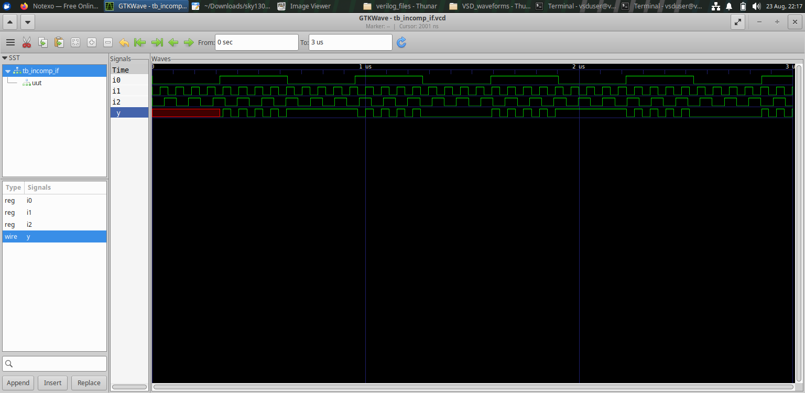

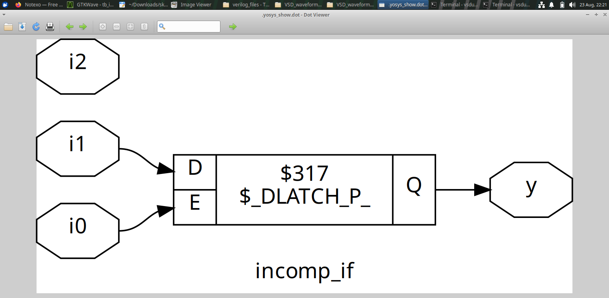

### Experiment 2

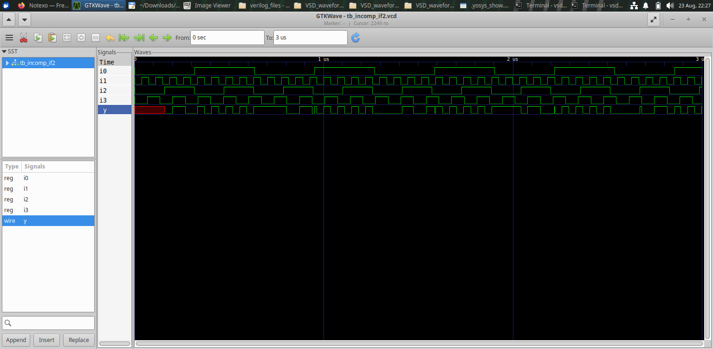


These experiments demonstrate how incomplete combinational assignments affect the inferred hardware structure.

---

## 3. Incomplete Case Statements

### Simulation

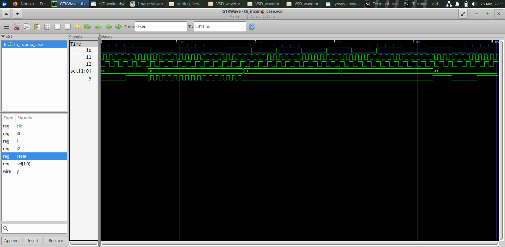

### Synthesized Structure

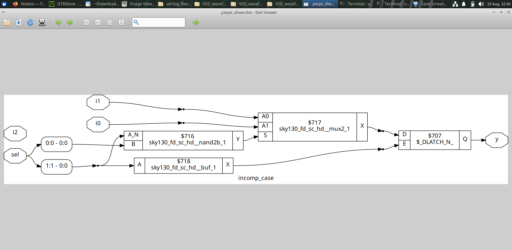

The experiment provides a direct example of why all required output conditions should be considered when describing combinational logic.

---

## 4. Complete Case Statements

### Simulation

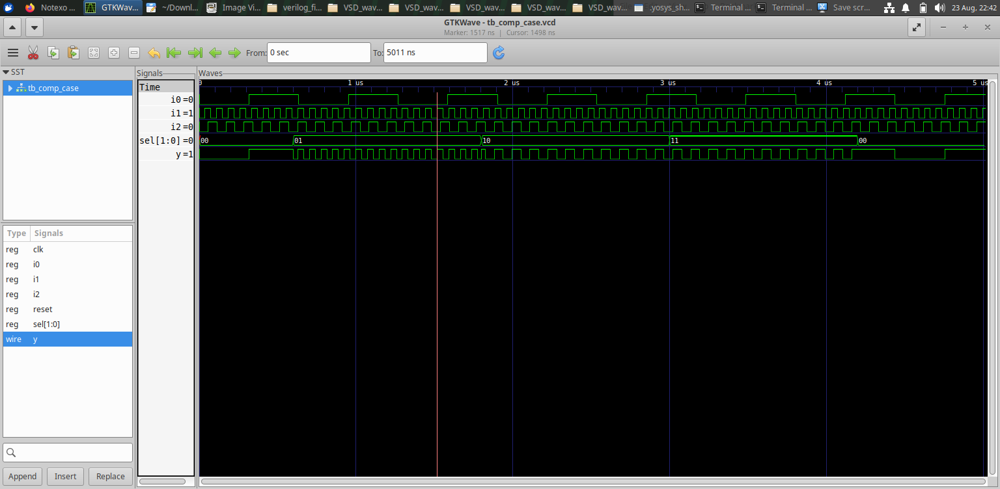

### Synthesized Structure

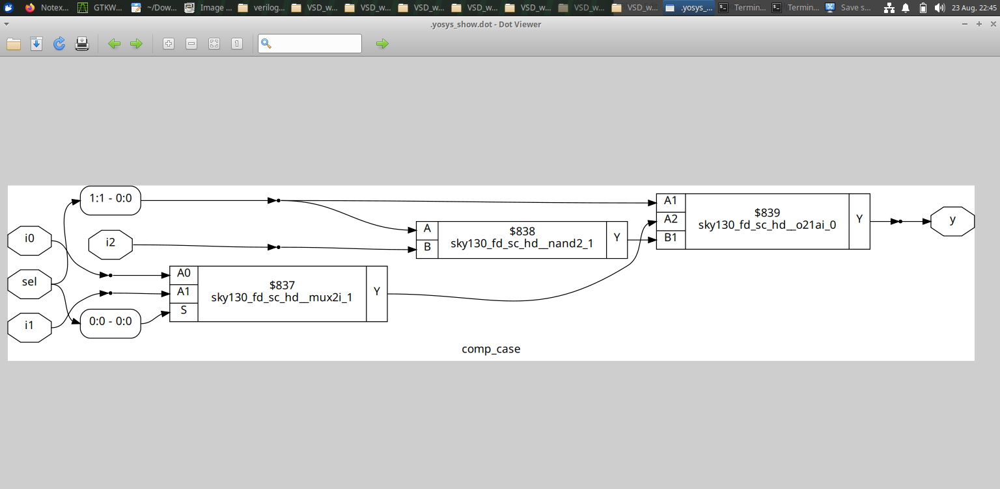

The complete-case result can be compared against the incomplete-case result to understand how assignment completeness changes the inferred implementation.

---

## 5. Partial Case Assignment

The supplied synthesized result for partial case assignment is:

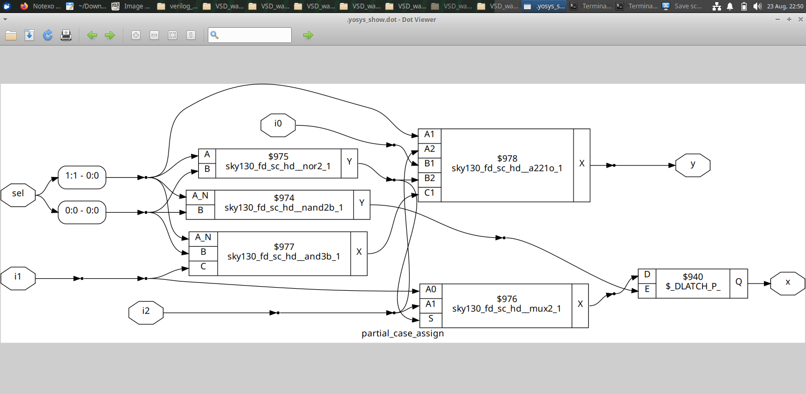

This provides another example of how partially specified outputs affect synthesis.

---

## 6. MUX and DEMUX

The module includes different RTL representations of MUX and DEMUX behavior.

### DEMUX Using Case

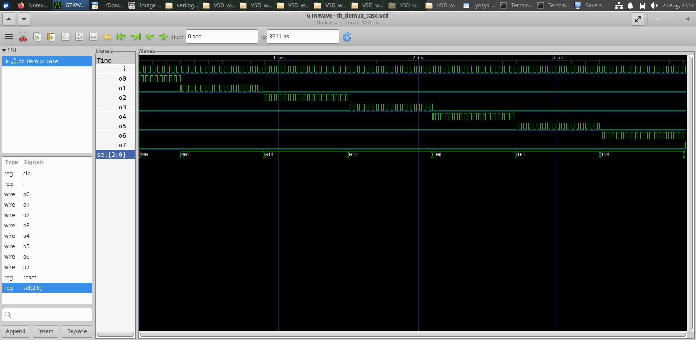

### MUX Using Generate

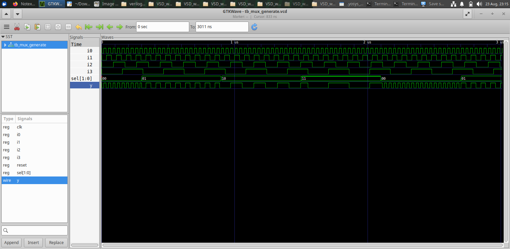

### DEMUX Using Generate


These experiments demonstrate that the same general hardware function can be expressed through different RTL structures.

---

## 7. Generate-Based Structures

The `generate` construct is useful when a design contains repeated or systematically connected hardware.

Conceptually:

```text
Generate Construct
       ↓
Repeated RTL Instances
       ↓
Synthesized Logic
```

The MUX and DEMUX experiments provide practical examples of this style.

---

## 8. Ripple-Carry Adder

The module also includes an RCA simulation result.

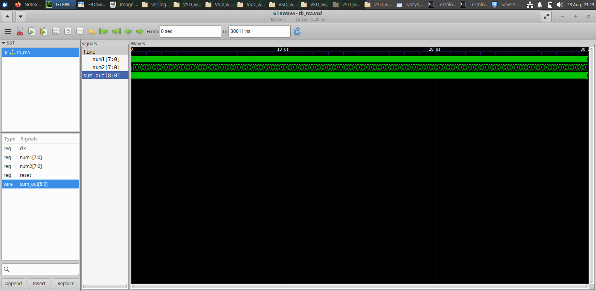

The waveform provides the simulation view of the ripple-carry-adder experiment.

---

## 9. Synthesis-Aware RTL

The central idea of Module 5 is that RTL is not only a functional description; it is also an input to a synthesis process.

When writing combinational RTL, the designer should consider:

```text
Is every required condition covered?
        ↓
Is every output assigned appropriately?
        ↓
What hardware will synthesis infer?
        ↓
Does the synthesized structure match intent?
```

This mindset helps avoid unintended storage or unexpected hardware structures.

---

## 10. Key Learning

- Incomplete `if`/`case` descriptions can change the inferred hardware.
- Complete combinational descriptions make hardware intent clearer.
- Partial assignments must be understood carefully.
- MUX and DEMUX logic can be expressed in multiple RTL styles.
- `generate` constructs are useful for repeated hardware.
- Simulation waveforms and synthesized structures should be studied together.

---

## 11. Module Takeaway

Module 5 brings together the main lessons from the workshop:

```text
RTL Coding Style
       ↓
Hardware Inference
       ↓
Synthesis Optimization
       ↓
Netlist
       ↓
Verification
```

The key design principle is to write RTL that is both **functionally correct and clear in its intended hardware behavior**.
