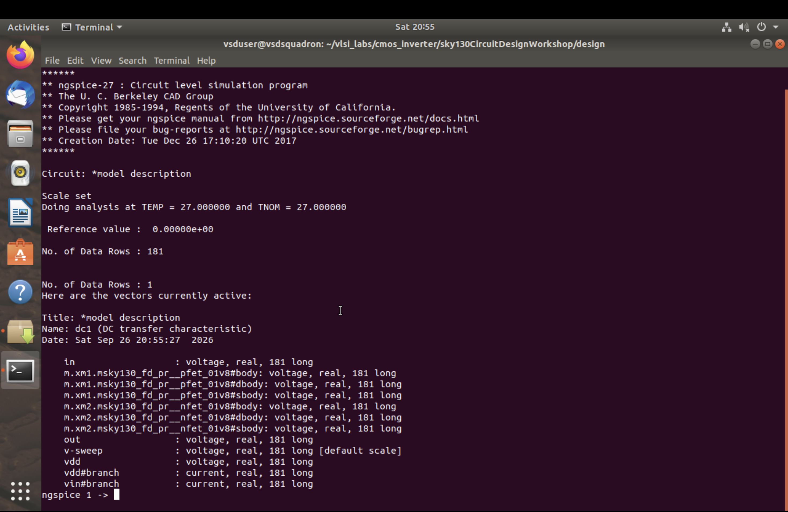
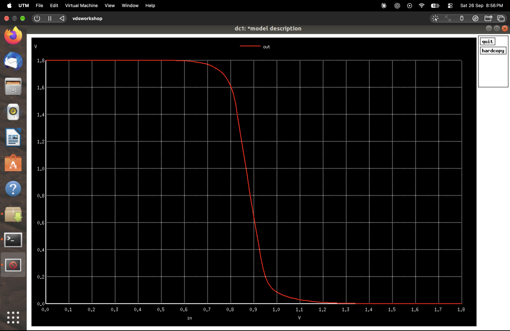
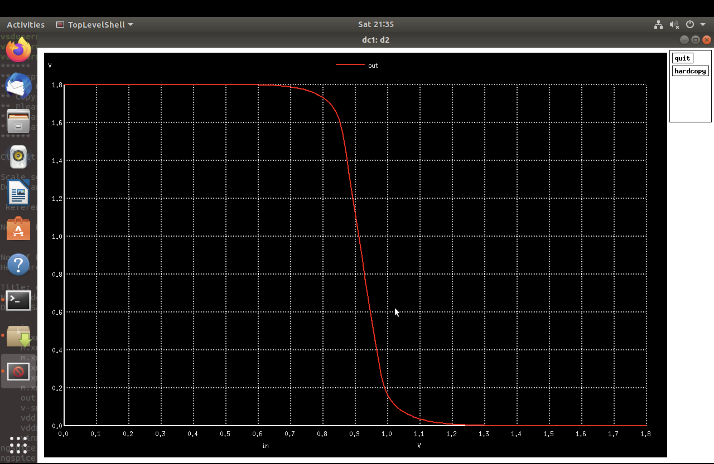
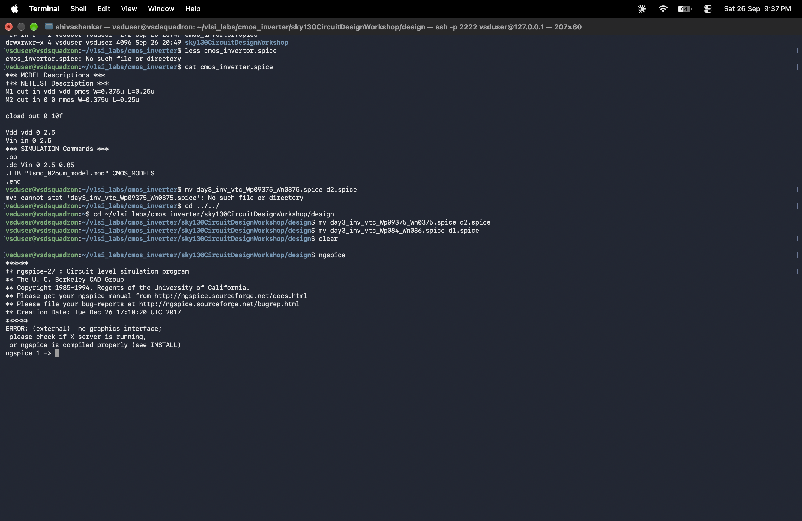
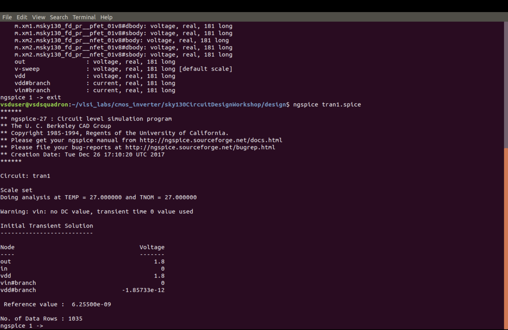
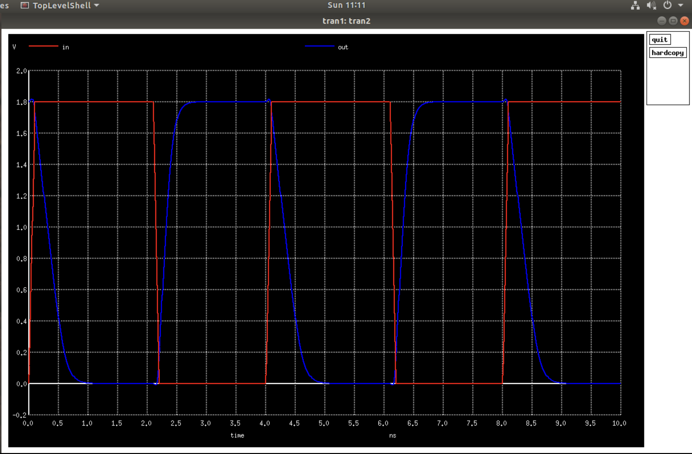
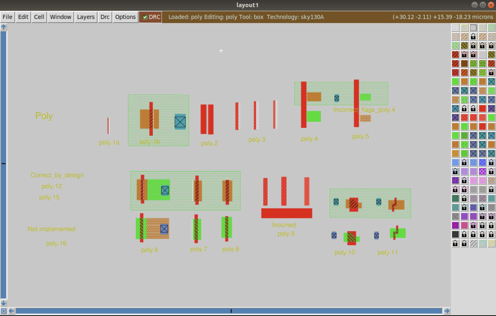
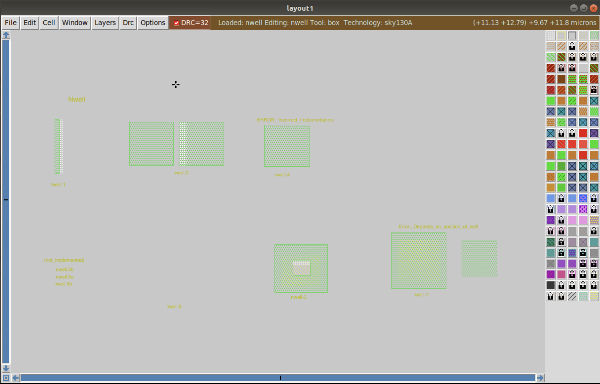

# Module 8: Design Library Cell Using Magic Layout and ngspice Characterization

## 📌 Module Overview

This module focuses on CMOS inverter characterization, physical layout design, extracted-netlist simulation, and Design Rule Check (DRC) verification using the Sky130A Process Design Kit (PDK).

The module is divided into three main sections:

- **SKY130_D3_SK1:** SPICE deck creation and ngspice simulation.
- **SKY130_D3_SK2:** CMOS inverter layout using Magic and extracted-netlist simulation.
- **SKY130_D3_SK3:** Sky130 technology-file DRC experiments for polysilicon and N-well layers.

The experiments demonstrate how transistor sizing influences inverter behavior, how a schematic-level circuit is translated into a physical layout, and how design rules are checked during VLSI implementation.

## 🎯 Learning Objectives

- Create SPICE netlists for CMOS inverter circuits.
- Perform DC sweep analysis using ngspice.
- Plot and interpret voltage transfer characteristics (VTCs).
- Compare inverter behavior for different PMOS transistor widths.
- Perform transient analysis using pulsed input signals.
- Design and inspect a CMOS inverter layout in Magic.
- Extract a SPICE netlist from the physical layout.
- Simulate the extracted circuit and observe its output response.
- Understand Sky130 polysilicon and N-well design rules.
- Identify layout violations using Magic DRC commands.

## 🛠️ Tools and Technologies

| Tool / Technology | Purpose |
|---|---|
| NGSpice | DC and transient circuit simulation |
| Magic VLSI Layout Tool | Physical layout creation and DRC verification |
| Sky130A PDK | Transistor models and layout design rules |
| SPICE | Circuit description and simulation |
| Linux Terminal | Running simulations and layout commands |

## 📂 Module Contents

The screenshots and experiment evidence are organized according to the three sections of Module 3.

## 1. SKY130_D3_SK1: SPICE Deck Creation and ngspice Simulation

This section studies a CMOS inverter using two transistor-sizing configurations. The SPICE decks use Sky130 device models to analyze the inverter's DC transfer characteristics and transient response.

### 1.1 `d1_spice.png` — First Inverter SPICE Deck

This screenshot shows the SPICE netlist for the first inverter configuration.

- PMOS width: 0.84 µm
- NMOS width: 0.36 µm

The configuration serves as the baseline for comparing the effects of transistor sizing on inverter switching behavior.



### 1.2 `d1_plot_in_vs_out.png` — First-Case DC Transfer Characteristic

This plot shows the output voltage as the input voltage is swept from low to high.

The output remains near the supply voltage at low input levels and decreases toward ground as the input crosses the switching region. The plot demonstrates the voltage-inverting behavior of the CMOS circuit.



### 1.3 `d2_spice.png` — Second Inverter SPICE Deck

This screenshot shows the second inverter configuration.

- PMOS width: 2.1 µm
- NMOS width: 0.36 µm

The PMOS width is increased while the NMOS width remains unchanged. This allows the effect of the relative pull-up and pull-down transistor strengths to be studied.


### 1.4 `d2_plot_in_vs_out.png` — Second-Case DC Transfer Characteristic

This plot shows the voltage transfer characteristic of the second configuration. Comparing it with the first case helps demonstrate how increasing the PMOS width affects the switching region.

The exact switching threshold should be obtained from the simulated curve rather than assumed from transistor dimensions alone.



### 1.5 `ng_spice.png` — NGSpice Simulation Console

This screenshot records the ngspice simulation session, including the active circuit, available voltage and current vectors, and simulation information.

It provides evidence that the circuit netlist was loaded and that simulation data was generated for waveform analysis.



### 1.6 `ngspice_transcient1.png` — Initial Transient Simulation for Case d1

This waveform shows the input and output voltages during transient analysis of the first inverter configuration.

The output is inverted relative to the input. When the input is high, the output moves toward ground; when the input is low, the output moves toward the supply voltage.

The transition curves also demonstrate that practical transistor-level switching takes a finite amount of time.



### 1.7 `SKY_D3_SK1_L4_transient_t1.png` — Final Transient Plot for Case d1

This screenshot presents the transient waveform for the first transistor-sizing configuration.

The input and output traces can be used to observe the switching behavior and, with appropriate waveform measurements, estimate propagation delay, rise time, and fall time.


### 1.8 `ngspice_transcient2.png` — Initial Transient Simulation for Case d2

This screenshot shows the transient response for the second inverter configuration, in which the PMOS transistor is wider than in case d1.

Comparing the output transitions with those of case d1 helps investigate the influence of PMOS drive strength on the output response.


### 1.9 `SKY_D3_SK1_L4_transient_t2.png` — Final Transient Plot for Case d2

This is the final transient waveform for the second configuration. It can be compared with the d1 waveform to evaluate changes in switching behavior.

For a reliable comparison, both simulations should use the same supply voltage, input pulse, load conditions, and measurement definitions.



## 2. SKY130_D3_SK2: Magic Layout and Extracted-Netlist Simulation

This section connects transistor-level simulation with the physical implementation of the CMOS inverter.

### 2.1 `SKY_D3_SK2_L1_inverter_layout_magic.png` — CMOS Inverter Layout in Magic

This screenshot shows the CMOS inverter layout opened in Magic using the Sky130A technology setup.

The physical implementation contains transistor geometry, polysilicon gates, diffusion regions, contacts, and interconnections. The labeled regions indicate the input, output, supply, and ground connections.

The layout represents the geometrical structure corresponding to the inverter circuit.


### 2.2 `SKY_D3_SK2_L4_transient_output_layout_extracted.png` — Extracted-Layout Transient Simulation

This screenshot documents the transient response associated with the layout-extracted inverter netlist.

The layout extraction process converts physical geometry and connectivity into a circuit representation that can be simulated using ngspice.

The waveform is used to check whether the extracted circuit retains the expected inverter behavior. The influence of parasitic resistance and capacitance depends on the extraction configuration.


### Layout Extraction Workflow

The general extraction workflow in Magic is:

```text
Open the inverter layout
        |
        v
Check connectivity and layout
        |
        v
Run DRC verification
        |
        v
extract all
        |
        v
ext2spice
        |
        v
Inspect the extracted SPICE netlist
        |
        v
Simulate using ngspice
        |
        v
Observe the transient response
```

The exact extraction commands and file names may depend on the project setup and the installed Magic configuration.

## 3. SKY130_D3_SK3: Sky130 Technology-File DRC Labs

This section studies design rules associated with polysilicon and N-well geometry using test layouts in Magic.

The test cells include examples intended to demonstrate different geometric conditions. DRC results are used to identify violations and relate the reported rules to the corresponding layout shapes.

### 3.1 `SKY_D3_SK3_L1_poly_drc_layout.png` — Polysilicon DRC Test Layout

This screenshot shows the polysilicon test layout in Magic.

The layout includes examples used to study polysilicon width, spacing, overhang, gate geometry, and related technology rules. Different regions illustrate geometries that are intended to demonstrate compliant and noncompliant cases.



### 3.2 `SKY_D3_SK3_L1_poly_drc_log.png` — Polysilicon DRC Results

This screenshot shows the DRC messages reported by Magic for the polysilicon test layout.

The displayed checks include examples involving:

- Minimum polysilicon width
- Minimum polysilicon spacing
- Polysilicon-to-diffusion spacing
- Transistor gate geometry
- Diffusion overhang
- Tap spacing and resistor-related rules

The reported messages can be matched with the corresponding regions in the layout to understand why a particular shape violates a design rule.


### 3.3 `SKY_D3_SK3_L2_nwell_drc_layout.png` — N-Well DRC Test Layout

This screenshot shows the N-well test layout used to examine well geometry rules.

The layout contains example shapes that help demonstrate minimum well width, spacing, and overlap requirements.



### 3.4 `SKY_D3_SK3_L2_nwell_drc_check.png` — N-Well DRC Results

This screenshot shows the N-well design-rule messages reported by Magic.

The checks include examples of:

- Minimum N-well width
- N-well overlap with deep N-well
- Minimum N-well spacing

These results demonstrate how the technology rules are applied to physical layout geometry. The layout should be modified as necessary to correct applicable violations.


## 🔄 Overall Workflow

The complete Module 3 workflow is summarized below.

1. Create SPICE decks for the two CMOS inverter configurations.
2. Run DC sweep analysis in ngspice.
3. Generate and compare the voltage transfer characteristics.
4. Run transient simulations using pulsed input signals.
5. Compare the electrical behavior of the two sizing configurations.
6. Create and inspect the inverter layout in Magic.
7. Extract the layout netlist and simulate the extracted circuit.
8. Open the polysilicon and N-well test layouts.
9. Run DRC checks and inspect the reported violations.

## 📊 Results and Observations

The experiments demonstrate the following:

- The CMOS inverter produces an output voltage that is inverted relative to the input.
- DC transfer curves reveal the inverter's switching region.
- Increasing the PMOS width changes the balance between pull-up and pull-down drive strengths.
- Transient simulations demonstrate the dynamic switching behavior of both sizing configurations.
- Magic provides a physical representation of the CMOS inverter layout.
- Extracted-netlist simulation connects the physical implementation to circuit-level analysis.
- DRC results identify geometric issues related to polysilicon and N-well design rules.

Actual switching thresholds, propagation delays, and other numerical measurements should be reported from the simulation data.

## 🧠 Key Concepts Learned

- CMOS transistor operation
- SPICE deck creation
- DC sweep analysis
- Voltage transfer characteristics
- PMOS and NMOS sizing
- Transient response and switching delay
- Physical layout design
- Layout-to-SPICE extraction
- Sky130 technology rules
- Polysilicon and N-well DRC verification

## 🚀 Future Improvements

- Measure the inverter switching threshold and noise margins.
- Calculate propagation delay, rise time, and fall time.
- Compare different PMOS-to-NMOS sizing ratios.
- Analyze power consumption and short-circuit current.
- Perform parasitic extraction and post-layout simulation.
- Correct all applicable layout violations and confirm the final DRC status.
- Extend the experiments to NAND, NOR, XOR, and other standard logic cells.

## 📝 Conclusion

Module 3 demonstrates the process of characterizing a CMOS inverter, implementing its physical layout, and examining technology-specific design rules using the Sky130A PDK.

NGSpice is used to perform DC and transient simulations, while Magic is used for physical layout inspection, netlist extraction, and DRC verification. The two transistor-sizing configurations provide a basis for comparing inverter electrical behavior.

The module builds practical understanding of transistor-level simulation, layout implementation, and physical verification, which are essential steps in a standard-cell VLSI design workflow.

## 👨‍💻 Author

- **Name:** M.Pranay Kumar pin:25eg504e02
- **Module:** Module 8 — Design Library Cell Using Magic Layout and ngspice Characterization
- **Technology:** Sky130A
- **Simulation Tool:** NGSpice
- **Layout Tool:** Magic VLSI Layout Tool

- **Roll No.:** 24EG104E28
- **College:** Anurag University
