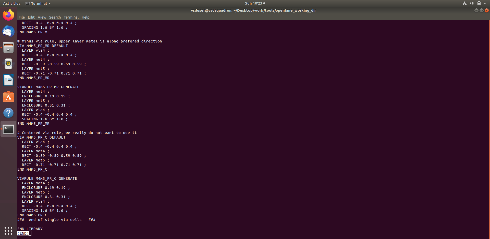
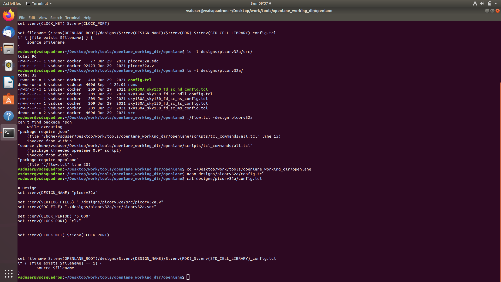
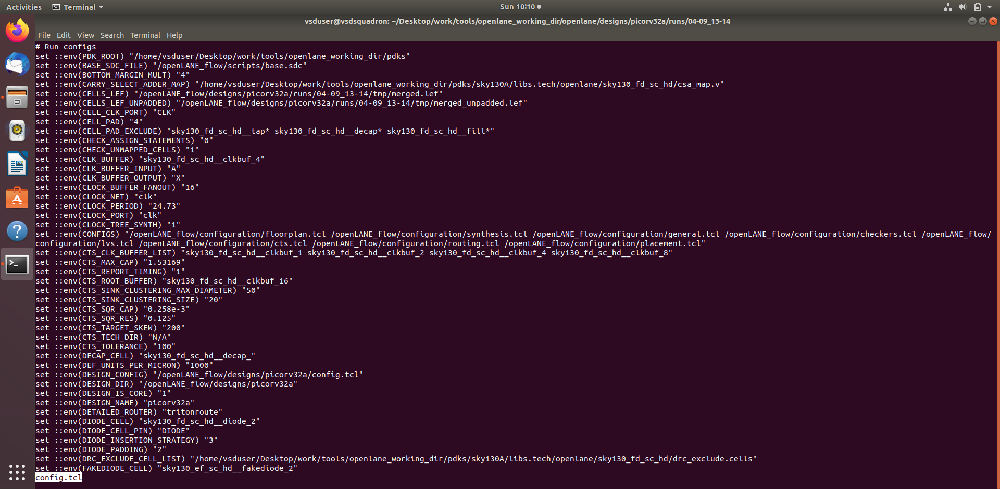
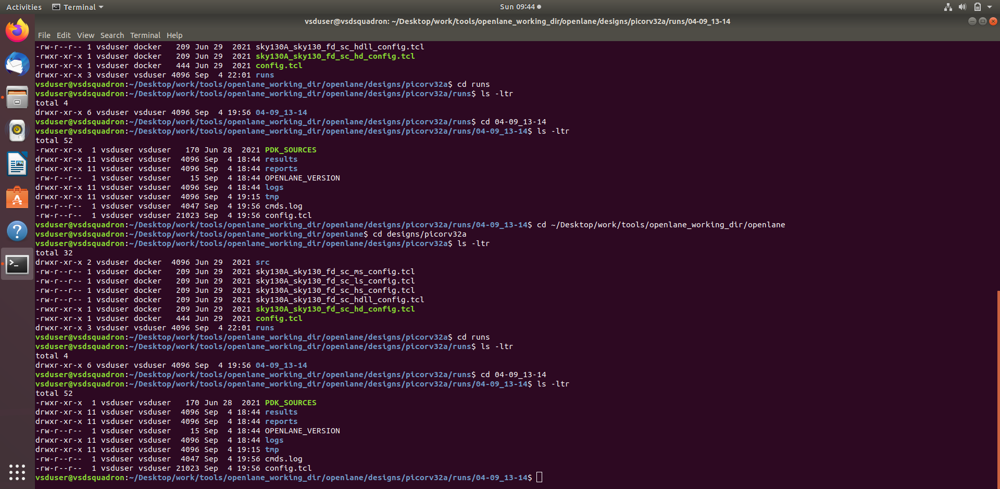
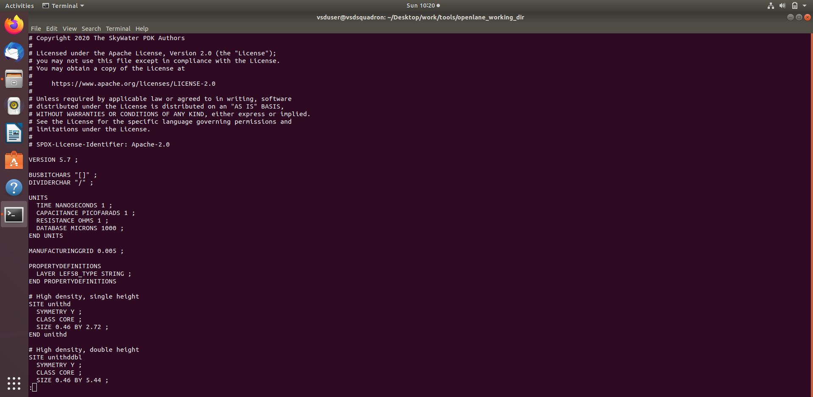
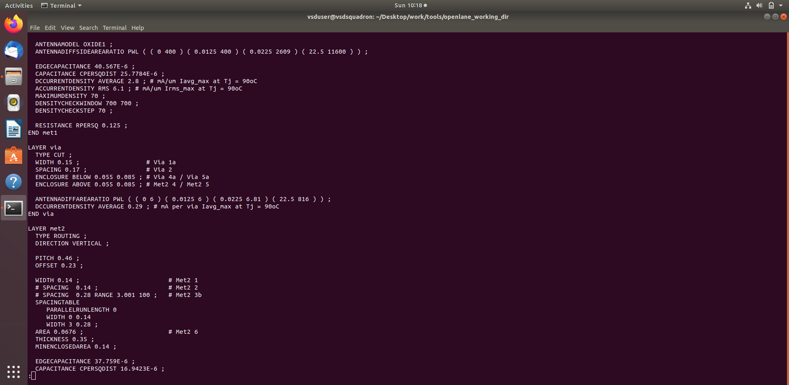
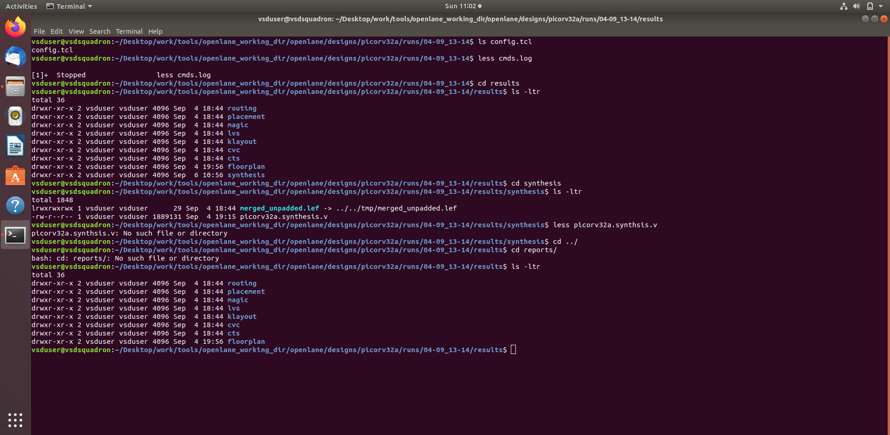
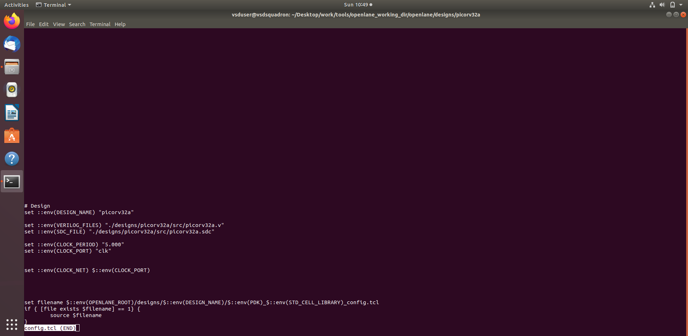
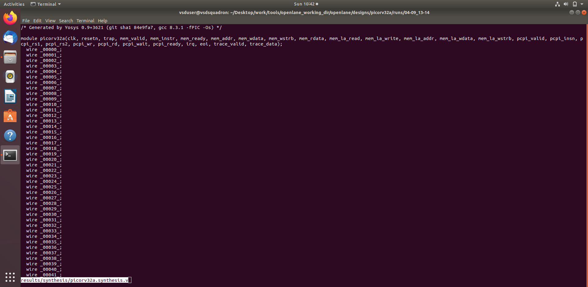

# MODULE 1 — RTL Design Workshop

## OpenLane, Sky130, Synthesis and Static Timing Analysis (STA)

### 1. Objective

Module 6 covers the RTL-to-synthesis and timing-analysis stage of the ASIC design flow using the **PicoRV32A** design with the **OpenLane/Sky130** environment.

This README is prepared from the files supplied in the Module 6 package. The supplied screenshot filenames are preserved and embedded directly for GitHub viewing.

### 2. Topics Covered

- OpenLane design environment
- Sky130 technology information
- LEF / merged-LEF inspection
- PicoRV32A design configuration
- OpenLane configuration files
- Synthesis
- Synthesized netlist
- Synthesis reports and statistics
- OpenSTA static timing analysis
- Timing-analysis evidence
- Relationship between RTL, technology files, constraints and synthesis

### 3. RTL-to-STA Flow

```text
RTL Design
   ↓
OpenLane / Design Configuration
   ↓
Sky130 Technology / LEF
   ↓
Synthesis
   ↓
Synthesized Netlist
   ↓
Synthesis Reports & Statistics
   ↓
OpenSTA / Static Timing Analysis
```

### 4. Supplied Evidence

### 1. `less_merged13.png`



### 2. `config_tcl11.png`



### 3. `less_config11.png`



### 4. `design_picorva11.png`



### 5. `picorv32a stats11.png`


### 6. `less_merged12.png`



### 7. `less_merged11.png`



### 8. `synthesis_report11.png`



### 9. `sky130_tcl11.png`



### 10. `picorv32a_syn_net11.png`




### 5. Key Learning

1. Understand how RTL is prepared for an ASIC implementation flow.
2. Understand the role of technology and LEF information.
3. Review OpenLane configuration used by the design.
4. Understand synthesis output and synthesized netlist information.
5. Inspect synthesis reports and design statistics.
6. Understand the purpose of Static Timing Analysis.
7. Relate timing constraints to the synthesized design.

### 6. Evidence Integrity

The screenshots in this README are taken from the uploaded Module 6 package. File names have been retained as supplied and no screenshot or result has been fabricated.

### 7. Conclusion

Module 6 provides the synthesis and timing-analysis foundation of the RTL-to-GDSII flow. It demonstrates how the PicoRV32A RTL is configured, synthesized and analyzed before proceeding to detailed physical implementation.
