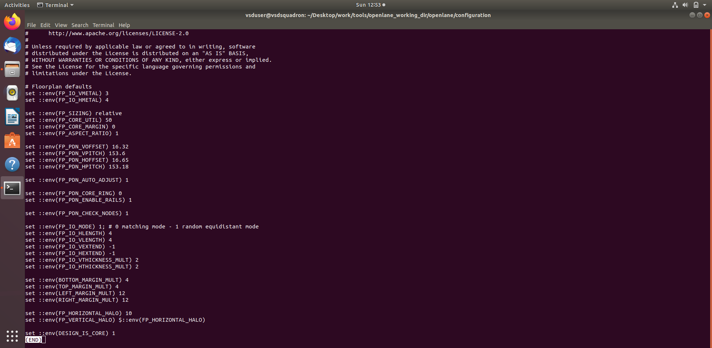
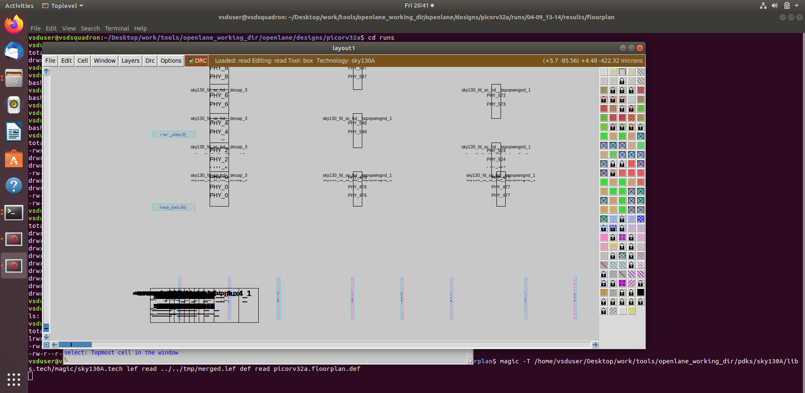
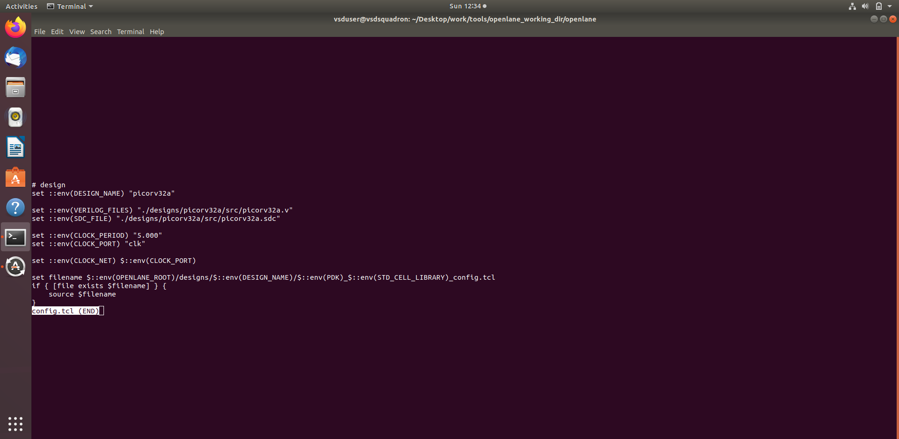
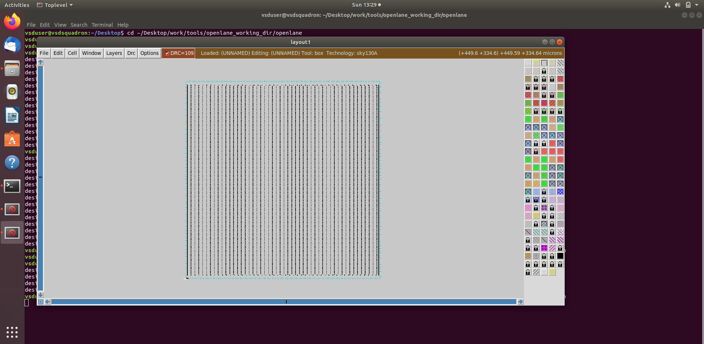

# MODULE 2 — RTL Design Workshop

## Physical Design, Floorplanning, Layout and PDN

### 1. Objective

Module 7 covers the physical-design stage of the ASIC flow. The supplied evidence focuses on floorplan configuration, layout generation, Magic layout inspection and power-distribution-network (PDN) related results.

This README is prepared directly from the files supplied in the Module 7 package. The supplied screenshot filenames are preserved and embedded directly for GitHub viewing.

### 2. Topics Covered

- Physical-design configuration
- Floorplan configuration
- Core and die planning
- Layout generation
- Layout inspection in Magic
- PDN generation and inspection
- Relationship between configuration and physical layout

### 3. Physical-Design Flow

```text
Synthesized Design
       ↓
Physical-Design Configuration
       ↓
Floorplanning
       ↓
PDN Generation
       ↓
Physical Layout
       ↓
Magic / Layout Inspection
```

### 4. Supplied Evidence

### 1. `floorplan11.png`



### 2. `LAYOUT_IN_MAGIC11.png`



### 3. `config_tcls11.png`



### 4. `floor_planlayoutmagic11.png`



### 5. `config.tcl floorplans11.png`


### 6. `PDN11.png`


### 5. Key Learning

1. Understand the transition from synthesized logic to physical implementation.
2. Understand the purpose of floorplanning.
3. Relate floorplan configuration to the resulting layout.
4. Understand the role of the power-distribution network.
5. Inspect the physical layout using a layout viewer.
6. Understand how configuration parameters influence physical implementation.

### 6. Evidence Integrity

The screenshots in this README are taken from the uploaded Module 7 package. File names have been retained as supplied and no screenshot or result has been fabricated.

### 7. Conclusion

Module 7 demonstrates the beginning of physical implementation, connecting the synthesized design with floorplanning, PDN and physical-layout inspection. These steps form the basis for subsequent placement, CTS and routing in a complete RTL-to-GDSII flow.
