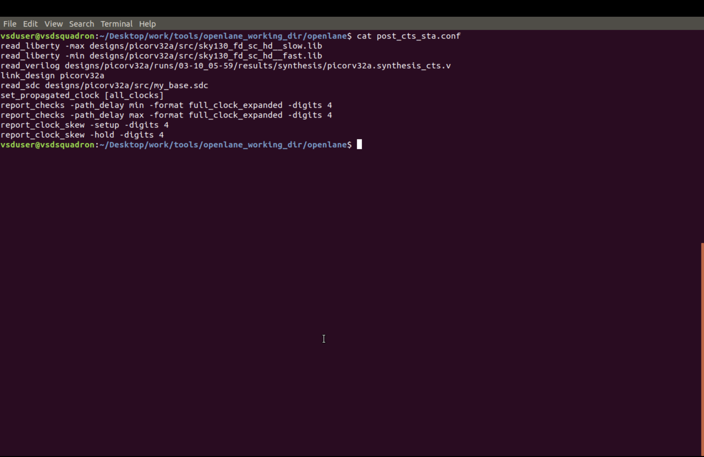
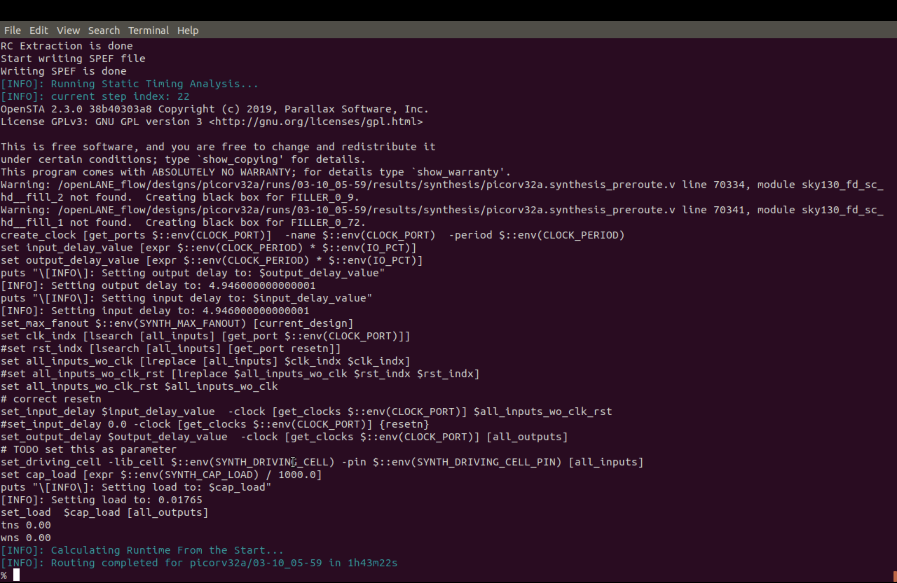

# Module 5: Final Physical Design Steps

This module covers the final physical-design stages of a Sky130 RTL-to-GDSII flow, including routing concepts, power-distribution network (PDN) generation, global routing, detailed routing, TritonRoute, and design-rule checking (DRC).

> **Documentation note:** This README outlines the workflow and the evidence to collect. Commands and report values should be taken from the actual run before describing a step as completed.

## Objectives

- Understand maze routing and the Lee routing algorithm.
- Review routing constraints and design-rule checking.
- Build and inspect the power-distribution network.
- Understand global routing and detailed routing.
- Run TritonRoute and analyze its routing results.
- Collect final implementation reports and supporting evidence.

## Workflow Overview

1. Review routing concepts and DRC.
2. Generate and inspect the power-distribution network.
3. Run global routing.
4. Run detailed routing with TritonRoute.
5. Review routing, DRC, timing, and area reports.
6. Save the final layout and supporting screenshots.

## 1. SKY130_D5_SK1 — Routing and Design-Rule Checking

Routing connects placed standard cells, the clock network, power network, and I/O pins while following the technology's physical-design rules. DRC checks the layout for violations of those rules.

### Lab steps

1. Review the concept of maze routing.
2. Study the operation and conclusions of Lee's routing algorithm.
3. Run design-rule checking (DRC) and inspect the report.

### Evidence

- Routing setup and relevant configuration: `01_post_cts_sta_configuration.png`
- Routing iterations: `02_tritonroute_iteration_06.png` and `03_tritonroute_iteration_25.png`
- Routing completion: `04_detailed_routing_completed.png`
- Routing violation-check evidence: `05_routing_violation_check.png`







**Results:** Record the DRC violation count and conclusions from the actual report. Do not claim zero violations unless the report confirms it.

## 2. SKY130_D5_SK2 — Power-Distribution Network

The power-distribution network (PDN) delivers power and ground to the standard cells. Depending on the design and configuration, it may include core rails, straps, rings, and connections between power ports and cell rows.

### Lab steps

1. Generate the power-distribution network using the flow's configuration.
2. Review the steps from power-grid setup to the completed network.
3. Inspect the generated rails, straps, and power connections.
4. Check power connectivity using the available flow reports or verification commands.

### Evidence and results to record

- PDN configuration and relevant commands.
- Generated files and reports.
- Screenshots showing the power rails and straps, if available.
- Power/ground connectivity-check results.
- Any warnings or errors reported by the tools.

**Results:** Describe what the actual PDN view and connectivity reports show. The screenshots currently included mainly document routing and timing; add a dedicated PDN screenshot/report if available.

## 3. SKY130_D5_SK3 — TritonRoute Flow

Global routing assigns approximate routing resources, while detailed routing creates the physical wire and via geometry needed to complete the connections. TritonRoute is used for detailed routing in the relevant OpenROAD/OpenLane flow.

### Lab steps

1. Review the TritonRoute features covered by the lab.
2. Study the routing method and its stages.
3. Run detailed routing using the project's configured flow.
4. Analyze the routing report and inspect the routed layout.

### Evidence

- Timing and routing log: `06_routing_wns_tns_log_query.png`
- Additional timing log: `07_routing_wns_tns_repeated_query.png`
- Post-route timing path: `08_post_route_timing_path_slack.png`
- Clock-skew/post-route STA log: `09_clock_skew_post_route_sta_log.png`
- Full routed layout: `10_magic_full_routed_layout.png`
- Zoomed routed layout: `11_magic_zoomed_routed_layout.png`


### Results to record

- TritonRoute completion status.
- Wire and via counts, if reported.
- DRC results and any remaining violations.
- WNS/TNS and other timing values exactly as shown in the reports.
- Routing-report observations, including warnings or failed connections.

**Results:** Add the actual report values and summarize whether routing completed successfully. Do not infer final timing closure or DRC cleanliness from a completed routing stage alone.

## Final Implementation Checklist

- [ ] Power-distribution network generated and checked.
- [ ] Global routing completed.
- [ ] Detailed routing completed.
- [ ] TritonRoute report saved and reviewed.
- [ ] DRC report collected and violation count recorded.
- [ ] Final layout screenshots attached.
- [ ] Final timing and area results recorded.
- [ ] Remaining warnings or violations documented.
- [ ] Final layout/database files saved in the project directory.

## Flow Summary

```text
Power-distribution network
          ↓
Global routing
          ↓
Detailed routing (TritonRoute)
          ↓
Routing report review
          ↓
Design-rule checking
          ↓
Final layout and implementation reports
```

The exact ordering of report generation and DRC checks depends on the flow configuration. Follow the actual run sequence shown in your tool logs.

## Notes and Attachments

The screenshots included in this folder are linked above using their exact filenames. Add any additional terminal commands, reports, PDN screenshots, final layout/database files, and conclusions from the actual run.

## Conclusion

This module provides a checklist for the final physical-design stages of a Sky130 RTL-to-GDSII flow. Successful completion should be supported by the actual PDN, routing, DRC, timing, and area reports. A completed routing stage alone does not establish that all design-rule checks passed or that final timing requirements were met.
